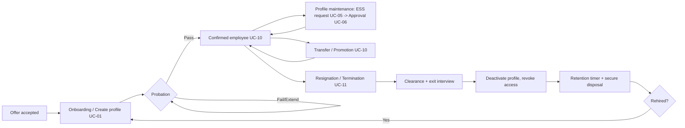
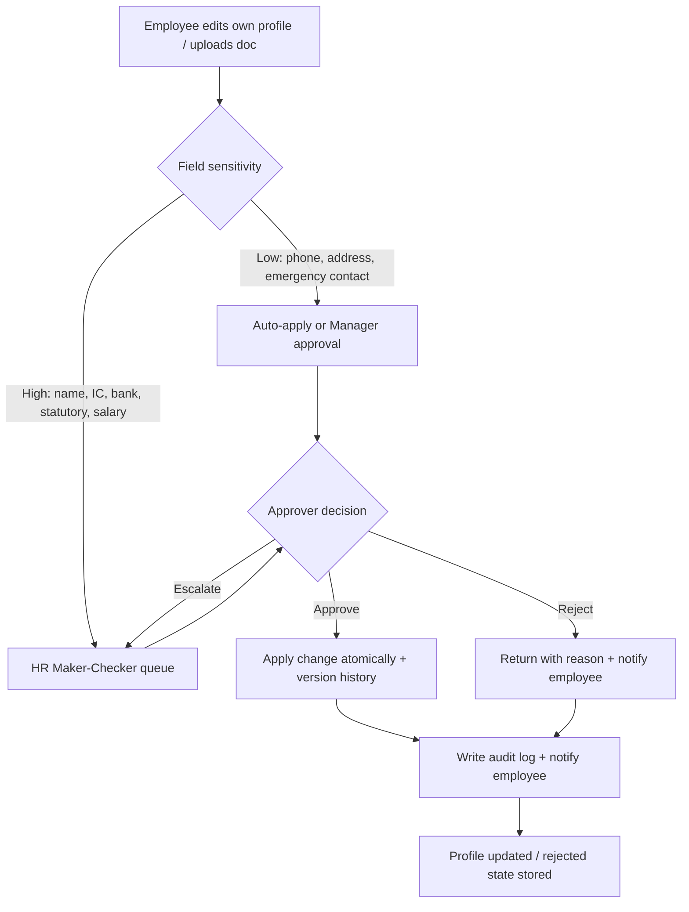
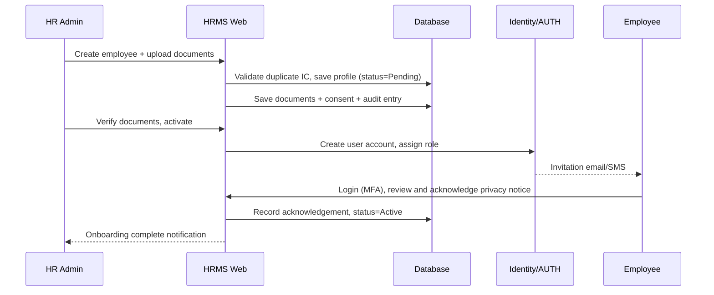
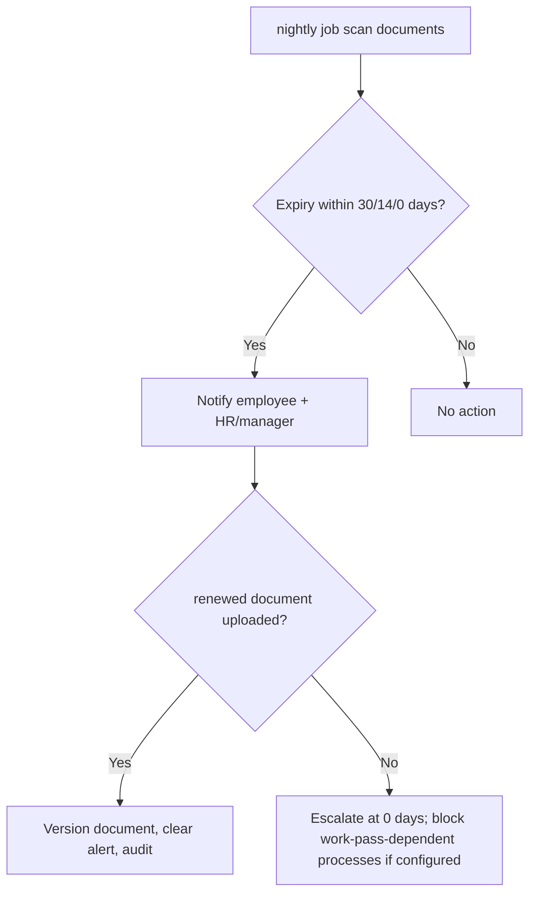
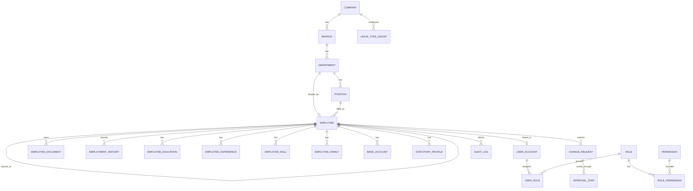

# 2en Apps HR Management System
## Module: Staff Profile and Details — Project Plan

| Item | Detail |
|---|---|
| Document | plan.md — Research, Use Case, Workflow & Database Plan |
| Version | 1.4 (Draft for review — email login, five roles and expanded personal details) |
| Date | 20 November 2026 |
| Owner | 2en Apps Sdn Bhd (product/HR project team) |
| Status | For discussion and approval |

> **Start here:** If you only want to run and understand the prototype, go straight to **§20 — Complete User Guide & Handover Documentation**. It contains the file list, demo logins, click-by-click walkthroughs, role matrix, verification checklist, known limitations and troubleshooting.

---

## 1. Executive Summary

This document defines the plan for the **Staff Profile and Details** module of the 2en Apps HR Management System. It covers the 5W1H of the project, findings from research on HR systems already operating in Malaysia, the proposed use cases and workflows, the application scheme (architecture/screens), and the database structure.

The module is the **master data foundation ("Core HR")** of the wider HRMS. Every other HR process — attendance, leave, claims, payroll, performance, and reporting — consumes the employee record created here. The design therefore prioritises: one canonical employee record, role-based data visibility, a full audit trail, and compliance with Malaysian statutory and PDPA requirements.

---

## 2. The 5W1H

### 2.1 What

Build a **Staff Profile and Details module** for an HR Management System that lets an organisation:

- Create and maintain a single, complete digital profile for each employee (personal, contact, family, employment, statutory, banking, education, skills, documents, and history).
- Provide **Employee Self-Service (ESS)** where staff view their own data and submit change requests.
- Give managers controlled visibility of their team's data and the ability to approve requests.
- Keep a tamper-evident **audit trail** of every change for compliance.
- Support the Malaysian employment lifecycle: onboarding → confirmation/transfer/promotion → offboarding → rehire.
- Produce statutory-ready data (Employment Act register, EPF/SOCSO/EIS/PCB/LHDN fields, HRD Corp) for downstream payroll.

**In scope (this module):** employee master data, organisation structure (company/branch/department/position), profile lifecycle, document repository with expiry alerts, ESS + approvals, reporting/export, audit log, roles & permissions.

**Out of scope (later modules, but integrated):** payroll computation, leave balance application, attendance capture, claims, recruitment/ATS, performance appraisal. This module exposes the interfaces they need (see §8.4).

### 2.2 When

| Dimension | Plan |
|---|---|
| Business timing | Continuous, daily operational use. Peak loads: start of month (HR updates/joiners), payroll cut-off, and annual EA/Form E season (Jan–Mar). |
| Data event timing | Profiles created at offer acceptance/onboarding; updated within **1–3 working days** of a change; statutory changes before the next contribution deadline (15th of the following month for EPF/PCB). |
| Retention timing | Employment Act 1955 s.61 register particulars: **≥ 6 years** after recorded; EPF wage records **≥ 6 years**; PERKESO/SOCSO and LHDN records **≥ 7 years**. PDPA: keep no longer than necessary, then securely dispose/anonymise. |
| Project timing | Phased delivery — see roadmap in §12. Target: MVP in 8–10 weeks, full module in 16–20 weeks. |

### 2.3 Where

- **Organisations:** Malaysian SMEs and mid-sized companies (2en Apps' client base and internal use), initially Peninsular Malaysia + Labuan (Employment Act 1955); Sabah/Sarawak labour ordinances to be configurable later.
- **Access channels:** Web application (HR/admin and manager portal) + responsive/mobile ESS for employees; optional APK/PWA using 2en Apps' mobile development capability.
- **Hosting:** Cloud, modular and multi-tenant, with data residency option in Malaysia; role- and entity-scoped access (support multiple companies/branches under one group).
- **Integration points:** payroll engine, attendance devices (biometric/QR/GPS), accounting, and notification services (email/SMS/WhatsApp).

### 2.4 Who

| Actor | Responsibility in this module |
|---|---|
| HR Administrator / HR Executive | Create and edit profiles, verify documents, run reports, manage lifecycle, maintain org structure. Primary day-to-day user. |
| HR Manager | Approve sensitive changes, view all staff, configure workflow, review audit and exception reports. |
| Line Manager / Department Head | View own team's profiles (restricted fields), approve ESS change requests and confirmations. |
| Employee | View own profile, update allowed personal fields, submit change requests, upload documents, view own history/payslips links. |
| Finance / Payroll Officer | Read-only access to salary, bank, and statutory fields needed for payroll. |
| System Administrator / IT | Manage users, roles, permissions, integrations, backups; **no routine access to salary data** unless explicitly granted. |
| Data Protection Officer (DPO) | Where applicable (PDPA thresholds), oversee privacy notices, consent records, breach response, and retention enforcement. |
| Auditor / Regulator | Export statutory registers and audit evidence on request. |

### 2.5 Why

**Problem:** HR data in many Malaysian SMEs is scattered across spreadsheets, paper files, and chat messages. This causes duplicated entry, stale records, lost documents, weak approval control, and difficulty producing records for LHDN/EPF/PERKESO or employee disputes.

**Objectives / benefits:**
1. **Single source of truth** — one employee record feeds all HR modules ("employee data should move once, not be entered again" — the pattern used by HRM.my, Frontier e-HR).
2. **Compliance** — statutory fields and retention rules built in; PDPA-aligned access control, consent and audit trail.
3. **Self-service** — employees maintain their own data, reducing HR admin by an industry-reported significant margin (ESS is standard in Kakitangan, Talenox, MiHCM, Orisoft, PayrollPanda).
4. **Data accuracy & traceability** — audit log of who viewed/changed salary and personal data; change approval prevents unauthorised edits.
5. **Better decisions** — reliable headcount, turnover, and demographic dashboards.
6. **Strategic fit** — extends 2en Apps' bespoke system development and outsourcing capabilities into a reusable HR product for its SME client base.

### 2.6 How

- **Approach:** Modular, cloud-based HRIS following the proven pattern of Malaysian vendors — start with Core HR, then plug in payroll/attendance/leave later without re-entering data.
- **Method:** Agile iterations; discover → design → build → pilot with one client/internal team → rollout. Configuration-driven (org structure, approval rules, field visibility, retention) rather than hard-coded.
- **Technology (indicative, to confirm):** PHP/Laravel or Node.js API, MySQL/PostgreSQL, React/Vue web ESS, REST APIs; encryption in transit (TLS) and at rest; SSO/MFA option. This aligns with 2en Apps' open-source/PHP and mobile app experience.
- **Controls:** RBAC + field-level permissions, maker–checker approval for sensitive changes,Immutable audit logs, document versioning, automated expiry/retention jobs, PDPA privacy notice and consent capture.

---

## 3. Research: Existing HR Systems in Malaysia

### 3.1 Market context

The Malaysian core HR software market is growing at roughly **9.7% CAGR (2024–2030)**, driven by cloud adoption and government digitalisation policy (DIF5). Cloud HRIS adoption is strongest among SMEs that need statutory payroll compliance and ESS without enterprise cost.

### 3.2 Vendor comparison (as of 2026)

| Platform | Origin / Fit | Relevant to Staff Profile module | Notes |
|---|---|---|---|
| **HRM.my** (BizCloud Asia) | Malaysia, modular, from ~RM50/module/month | Core HR: employee profiles, employment dates, documents, groups, departments, access permissions; ESS via web/app; one employee record across modules | Good model for "start with one module, add more" |
| **Kakitangan.com** | Malaysia SME, LHDN-approved | E-Payroll, E-Leave, E-Claim, E-Attendance, HR Premium; EPF/SOCSO/PCB/EIS; free tier ≤3 staff | Payroll-first; modular, basic HR depth |
| **Talenox Profiles** | Malaysia SME | "Employee Safe Box": personal, contact, next-of-kin, job history, salary, bank, EPF/SOCSO/LHDN numbers, visa/work permit; ESS with restricted fields; PDPA + ISO 27001, 2FA | Strong reference for field list and data security |
| **MiHCM Core** | Malaysia enterprise | Comprehensive digital profile with **timeline of employee lifecycle**, deactivated profiles for ex-employees, re-activation on rehire; personal/work/family/contact/medical/bank/experience/qualifications/skills/documents; disciplinary and offboarding | Best reference for profile depth & lifecycle timeline |
| **HRX by IFCA** | Malaysia, 1,300+ orgs | Unified AI-powered HRMS: personnel management, payroll, attendance, leave, claims, performance, recruitment, analytics | Enterprise-wide suite benchmark |
| **Orisoft (Vistra)** | Malaysia | Core HRMS: employee profile, correspondence/letter templates, leave, org charts, **audit trail** for unauthorised changes to employment/payroll data; ESS & mobile | Strong reference for audit trail + correspondence |
| **Frontier e-HR** | Malaysia | Personnel module: multi-company, jobs & posts with duties/responsibilities, manpower planning, career progression, structured resume, benefits, medical, self-service with **change requests** | Good reference for change-request workflow |
| **BR HRMS** | Malaysia SME, web + mobile, EN/BM/中文 | Employee records, HR files & letters, attendance, leave, claims, self-service, 30-day trial | Localised, multilingual UI reference |
| **Swingvy / BrioHR / PayrollPanda / HashMicro / Employment Hero / Akrivia HCM** | Regional/global | Vary from payroll-only (Kakitangan, PayrollPanda) to full suite + multi-country (Akrivia, Employment Hero) | Shows gap: SME-friendly, locally compliant, deep profile + ESS is competitive space |
| **SQL Payroll / Info-Tech / HR2eazy / ByteHR** | Malaysia | Accounting/finance-led or cost-conscious SME options | Most focus on payroll, not deep profile management |

### 3.3 Common patterns identified

1. **One employee record** shared across modules; attendance → payroll, approved claims → payroll.
2. **Digital profile with timeline** covering the whole lifecycle (MiHCM), including deactivated/rehired staff.
3. **ESS** for personal data, leave, payslips; manager can approve but cannot see everything.
4. **Restricted field access**, 2FA, encryption, PDPA compliance (Talenox, Kakitangan).
5. **Audit trail** for employment/payroll data changes (Orisoft).
6. **Document management** with correspondence/letter templates and mail merge.
7. **Mobile access** with geotagging/face recognition for attendance (sensitive-data implications).

### 3.4 Malaysian statutory & privacy requirements to embed

| Area | Requirement | Design implication |
|---|---|---|
| Employment Act 1955 (s.61) + Employment Regulations 1957 | Maintain prescribed employee register; preserve each particular **≥ 6 years** | Register export; retention timer per record |
| EPF (KWSP) Act 1991 s.42 | Wage/EPF records **≥ 6 years**; monthly payslip showing employer/employee share | Store EPF number, contributions, wage history; payslip interface |
| PERKESO (SOCSO/EIS) | Records **≥ 7 years**; EIS 0.2% each, wage ceiling RM6,000 | Store SOCSO number, EIS eligibility, contribution fields |
| LHDN | Records **≥ 7 years**; PCB monthly by 15th; Form EA by 28 Feb; Form E + CP8D by 31 Mar | Store LHDN tax number, PCB and tax fields; year-end export |
| HRD Corp | 1% levy (≥10 citizen employees); training records for claims | Store HRD Corp registration/levy fields |
| PDPA 2010 + Amendment 2024 | Lawful processing, notice & consent, data minimisation, security, retention, access & portability; **biometrics are sensitive** (explicit consent); DPO & breach notification duties | Privacy notice at collection, consent flags, sensitive-data classification, access control, audit log, retention/deletion job, export, breach workflow |
| Minimum Wage Order 2024 | RM1,700/month | Validation warning in salary fields |
| Sabah/Sarawak | Separate labour ordinances | Configurable rule set by entity/region |

> Note: rates and rules change; they belong in a **versioned reference/rule table**, not hard-coded logic. This plan records the current context only and must be validated with HR/legal before go-live.

---

## 4. Scope & Requirements

### 4.1 Functional requirements (priority: Must / Should / Could)

| ID | Requirement | Priority |
|---|---|---|
| FR-01 | Create employee profile with structured sections (personal, contact, family, employment, statutory, bank, education, experience, skills, documents) | Must |
| FR-02 | Unique employee ID (staff number) + link to login user account | Must |
| FR-03 | Search/filter/sort staff directory by name, ID, department, branch, status, position, manager | Must |
| FR-04 | View full profile with employment timeline | Must |
| FR-05 | Role- and field-level data visibility (HR, manager, employee, finance, auditor) | Must |
| FR-06 | ESS: employee views own profile and updates allowed fields | Must |
| FR-07 | Change request + approval workflow for sensitive fields (bank, statutory, salary, IC/name) | Must |
| FR-08 | Document upload/versioning, document types, expiry alerts (passport/work permit/contract) | Must |
| FR-09 | Complete audit log of create/view-sensitive/edit/approve/delete events | Must |
| FR-10 | Employee lifecycle: onboard → confirm → transfer/promote → resign → deactivate → rehire | Must |
| FR-11 | Org structure management (company/branch/department/position/manager) | Must |
| FR-12 | Export statutory employee register, headcount and demographic reports (CSV/Excel/PDF) | Should |
| FR-13 | Bulk import employees from spreadsheet with validation | Should |
| FR-14 | Correspondence: generate letters from templates using profile data | Should |
| FR-15 | Notifications (email/SMS/in-app/WhatsApp) for requests, expiry, birthdays, probation | Should |
| FR-16 | Data retention/anonymisation job per category | Should |
| FR-17 | PDPA consent records, privacy notice acknowledgement, data subject access/portability export | Should |
| FR-18 | Multi-language UI (EN/BM, optional 中文) | Could |
| FR-19 | Photo & face/GPS attendance enrolment with explicit sensitive-data consent | Could |

### 4.2 Non-functional requirements

- **Security:** TLS 1.2+, encryption at rest for ID/bank/salary/biometric fields, MFA/SSO, password policy, session timeout, field masking, audit immutability.
- **Performance:** profile list < 2s for 5,000 employees; search results paginated; report export asynchronous for large sets.
- **Availability:** 99.5% monthly; daily backups + restore test; disaster recovery documented.
- **Scalability:** multi-tenant, multi-company/branch, thousands of employees per tenant.
- **Usability:** role-based dashboards, mobile-responsive ESS, minimal training.
- **Compliance:** PDPA principles; data residency option in Malaysia; vendor processor obligations.
- **Maintainability:** versioned reference/rule tables; documented API; automated tests.

---

## 5. Use Cases

### 5.1 Use case catalogue

| ID | Use case | Primary actor | Priority |
|---|---|---|---|
| UC-01 | Onboard new employee / create profile | HR Administrator | Must |
| UC-02 | Search and view staff directory & full profile | HR / Manager | Must |
| UC-03 | Edit employee profile (HR, audited) | HR Administrator | Must |
| UC-04 | Employee self-service: view own profile | Employee | Must |
| UC-05 | Employee submits personal data change request | Employee | Must |
| UC-06 | Approve / reject change request | Manager / HR Manager | Must |
| UC-07 | Upload, replace and track employee documents | HR / Employee | Must |
| UC-08 | View employment history & lifecycle timeline | HR / Manager / Employee | Must |
| UC-09 | Manager views team profiles (restricted fields) | Line Manager | Must |
| UC-10 | Process confirmation, transfer or promotion | HR Manager | Must |
| UC-11 | Offboard (resign/terminate), deactivate and rehire | HR Administrator | Must |
| UC-12 | Manage users, roles and permissions | System Administrator | Must |
| UC-13 | Review audit log and exception reports | HR Manager / Auditor | Must |
| UC-14 | Bulk import / data migration | HR Administrator | Should |
| UC-15 | Export statutory register & HR reports | HR / Finance | Should |
| UC-16 | Generate HR letter from template | HR Administrator | Should |
| UC-17 | Capture PDPA consent / handle data access request | DPO / HR | Should |

### 5.2 Detailed use case specifications (key cases)

**UC-01 — Onboard new employee / create profile**
- *Actors:* HR Administrator (primary); Employee, IT (secondary).
- *Preconditions:* Offer accepted; HR has authority; required reference data exists.
- *Flow:* 1) HR opens "New Employee" → 2) enters identity details (name, IC/passport, DOB, nationality) → system validates format & duplicates → 3) enters contact, family/next-of-kin, bank, statutory (EPF/SOCSO/EIS/LHDN), employment details (position, department, branch, manager, hire date, employment type, probation) → 4) uploads documents (IC, passport, contracts, certificates) and records expiry → 5) captures PDPA privacy notice acknowledgement/consent → 6) system generates Employee ID, creates login account, assigns role → 7) notifies employee and manager → 8) all changes written to audit log.
- *Postconditions:* Active employee profile exists; ESS account active; history entry "Onboarded" created.
- *Alternate:* Duplicate IC/passport → warn and block; missing mandatory doc → save as "Pending" state.

**UC-05 — Employee submits personal data change request**
- *Actors:* Employee; approver from UC-06.
- *Preconditions:* Employee authenticated; field is classified as "request-only".
- *Flow:* 1) Employee opens "My Profile" → 2) edits allowed field (e.g. phone, address, emergency contact) and/or uploads supporting doc → 3) submits → 4) system determines approval route by field sensitivity (self-update vs manager vs HR) → 5) request queued with status Pending → 6) notifications sent.
- *Postconditions:* Change request record created; profile not yet changed.
- *Business rule:* Changes to bank account, statutory numbers, legal name, IC, or salary **always** require HR maker–checker approval.

**UC-06 — Approve / reject change request**
- *Actors:* Line Manager or HR Manager.
- *Flow:* 1) Approver sees request in task inbox with old vs proposed value → 2) reviews supporting document → 3) approves, rejects (with reason), or escalates → 4) system applies change atomically to the profile, appends a **history version**, writes audit entry with approver identity/date/reason → 5) notifies employee.
- *Postconditions:* Approved changes reflected everywhere; rejected changes logged with reason.

**UC-07 — Document management**
- *Actors:* HR / Employee.
- *Flow:* upload → choose type → validate file type/size/virus scan → store (versioned, encrypted) → set issue/expiry dates → link to employee → schedule expiry alert (30/14/0 days) → auditor can view download log.
- *Special:* Work pass/visa expiry triggers escalation to HR and manager.

**UC-11 — Offboarding and rehire**
- *Flow:* resignation/termination → record notice date, last working day, reason → clearance checklist (items, access, final pay link) → exit interview → deactivate profile (status = Ex-Employee; retain history, revoke login, restrict data) → retention timers start → optional rehire: reactivate/create new employment record while preserving prior history (MiHCM pattern).

---

## 6. Workflows

### 6.1 Employee data lifecycle (master flow)



### 6.2 Change request & approval workflow



### 6.3 Onboarding sequence (systems interaction)



### 6.4 Document expiry monitoring (scheduled)



---

## 7. Application Scheme (UI / Module Structure)

### 7.1 Module map

```
HRMS Platform
├── Core HR (this module)
│   ├── Dashboard (HR: headcount, joiners/leavers, expiring docs, pending requests)
│   ├── Staff Directory (search, filter, list, bulk actions)
│   ├── Employee Profile (sections below)
│   │   ├── Personal & Identity
│   │   ├── Contact & Address
│   │   ├── Family / Next-of-Kin / Dependants
│   │   ├── Employment Details & Timeline
│   │   ├── Position / Reporting Line
│   │   ├── Compensation & Statutory (restricted)
│   │   ├── Bank Account (restricted)
│   │   ├── Education / Skills / Experience / Memberships
│   │   ├── Documents & Correspondence
│   │   └── Consent & Privacy
│   ├── Organisation Structure (Company > Branch > Dept > Position)
│   ├── Change Requests / Approval Inbox
│   ├── Document Centre & Expiry Alerts
│   ├── Reports & Exports (registers, headcount, demographics)
│   ├── Audit Log
│   └── Admin: Users, Roles, Permissions, Reference Data, Retention Rules
├── Employee Self-Service (ESS): My Profile, My Requests, My Documents, My History
├── Manager Self-Service (MSS): Team Profiles, Approvals, Team Calendar
└── Future integrations: Payroll, Attendance, Leave, Claims, Performance
```

### 7.2 Screen sketch — Employee Profile (single-page, tabbed, permission-aware)

```
┌──────────────────────────────────────────────────────────────┐
│ [Photo] AINA BINTI RAHMAN   Employee ID: EMP-2026-0042       │
│ Executive · IT Department · Cyberjaya · Active · Manager: ...│
├────────┬────────┬────────┬────────┬────────┬────────┬────────┤
│Overview│Personal│Employment│Statutory│Docs│History│Requests│
├────────┴────────┴────────┴────────┴────────┴────────┴────────┤
│ Timeline: Onboarded ✓ → Confirmed ✓ → Transfer (2025) ✓      │
│ Action buttons: [Edit] [Request Change] [Upload Doc] [Export]│
│ Field-level masks: bank/statutory visible to HR/Finance only │
└──────────────────────────────────────────────────────────────┘
```

### 7.3 Role & permission matrix (field-level; V = view, E = edit, A = approve)

| Data group | HR Admin | HR Manager | Line Manager | Employee | Finance | IT Admin | Auditor |
|---|---|---|---|---|---|---|---|
| Personal / contact | V,E | V,E | V (team, limited) | V,E* | – | – | V |
| Family / next-of-kin | V,E | V,E | – | V,E* | – | – | V |
| Employment details | V,E | V,E,A | V (team) | V | V | – | V |
| Salary / compensation | V | V,A | – | V (own) | V | – | V |
| Bank account | V,E | V,E,A | – | V (own, masked) | V | – | V |
| Statutory IDs (EPF/SOCSO/LHDN) | V,E | V,E,A | – | V (own) | V | – | V |
| Documents | V,E | V,E | V (team, limited) | V,E* | – | – | V + download log |
| Change requests | V | V,A | V,A (team) | V,E* | – | – | V |
| Audit log | V | V | – | V (own) | – | V | V |
| Users / roles | – | V | – | – | – | V,E | – |

\* Employee changes are submitted as requests and applied after approval where required (§6.2).

---

## 8. Database Structure

### 8.1 Design principles

- **Single canonical employee**: `employees` is the master; all other tables reference `employee_id`.
- **Tenant/entity scoping**: `company_id` on core tables; `branch_id`/`department_id` for row-level filtering.
- **Soft delete + status**: never hard-delete an employee; use `status` and `deleted_at`.
- **History/versioning**: employment events and sensitive field changes are append-only; current values mirrored on `employees` for speed.
- **Auditability**: `audit_logs` records actor, action, table, record id, before/after JSON, IP, timestamp.
- **Reference tables** for enumerations (gender, race, religion, nationality, state, bank, document type, employment type, leave type) so values are configurable and localised.
- **Sensitive fields** flagged for encryption at rest and extra access checks (IC, passport, bank, salary, biometrics, medical).
- **UTF-8MB4**, InnoDB, foreign keys, indexes on search columns; timestamps (`created_at`, `updated_at`, `created_by`, `updated_by`) on all tables.

### 8.2 Entity Relationship Diagram (core)



### 8.3 Table definitions (key tables)

**`companies`** — tenant/legal entity (supports multi-entity groups)
`id` PK, `name`, `registration_no` (SSM), `address`, `state`, `country`, `region_rule_set` (e.g. `EMACT_1955`, `SABAH`, `SARAWAK`), `hrd_corp_reg_no`, `epf_employer_no`, `socso_employer_no`, `lhdn_tax_no`, `is_active`, timestamps.

**`branches`** — `id` PK, `company_id` FK, `name`, `code`, `address`, `state`, `is_active`, timestamps.

**`departments`** — `id` PK, `company_id` FK, `branch_id` FK nullable, `parent_id` FK nullable (org tree), `name`, `code`, `head_employee_id` FK nullable, `cost_centre`, `is_active`, timestamps.

**`positions`** — `id` PK, `company_id` FK, `department_id` FK, `title`, `code`, `job_grade`, `job_description`, `duties_responsibilities` (text), `manpower_quota`, `is_active`, timestamps.

**`employees`** — master profile (core of the module)

| Column | Type / note |
|---|---|
| `id` | BIGINT PK |
| `employee_no` | VARCHAR unique (e.g. `EMP-2026-0042`) |
| `company_id`, `branch_id`, `department_id`, `position_id` | FKs |
| `reports_to_employee_id` | FK self (manager) |
| `user_id` | FK `user_accounts` nullable (login) |
| `first_name`, `last_name`, `full_name` | VARCHAR |
| `id_type` | FK ref (IC / Passport / Work Permit) |
| `id_number` | VARCHAR **encrypted**, unique per company |
| `date_of_birth`, `gender`, `race`, `religion`, `nationality`, `marital_status` | date / FK refs |
| `address_1`, `address_2`, `city`, `postcode`, `state`, `country` | VARCHAR |
| `phone`, `email` | VARCHAR (email unique) |
| `emergency_contact_name`, `emergency_contact_relationship`, `emergency_contact_phone` | VARCHAR |
| `next_of_kin_name`, `next_of_kin_relationship`, `next_of_kin_phone` | VARCHAR |
| `marital/dependant info` | via `employee_family` |
| `employment_type` | FK ref (Permanent / Contract / Intern / Foreign / Part-time) |
| `employment_status` | enum: `Pending, Probation, Active, OnLeave, Suspended, Resigned, Terminated, ExEmployee` |
| `hire_date`, `confirmation_date`, `probation_end_date`, `notice_date`, `last_working_day`, `termination_date` | dates |
| `probation_months`, `notice_period_days` | int |
| `basic_salary`, `salary_type` | DECIMAL/FK — **sensitive**, audited |
| `epf_member_no`, `socso_member_no`, `eis_indicator`, `lhdn_tax_no`, `hrd_corp_no`, `work_permit_no`, `work_permit_expiry` | VARCHAR/date — **sensitive** (moved to `statutory_profiles` if stricter isolation desired) |
| `bank_name`, `bank_account_no`, `bank_account_type` | **sensitive**, encrypted |
| `photo_path` | VARCHAR |
| `consent_pdpa_at`, `privacy_notice_version`, `consent_biometrics` | consent tracking |
| `retention_class`, `delete_after` | retention control |
| `created_by`, `updated_by`, `created_at`, `updated_at`, `deleted_at` | audit/soft delete |

*Indexes:* `employee_no`, `id_number`, `company_id+status`, `department_id`, `position_id`, `reports_to_employee_id`, full-text on `full_name`/`email`.

**`employment_history`** (append-only timeline)
`id`, `employee_id`, `event_type` (Onboard/Confirm/Transfer/Promotion/SalaryRevision/Discipline/Resign/Terminate/Rehire), `effective_date`, `from_position_id`, `to_position_id`, `from_department_id`, `to_department_id`, `from_salary`, `to_salary`, `change_reason`, `document_ref`, `created_by`, `created_at`.

**`employee_documents`**
`id`, `employee_id`, `document_type` (FK ref: IC, Passport, Contract, Certificate, Medical, WorkPermit, Letter…), `title`, `file_path` (encrypted storage), `file_hash`, `mime_type`, `size_bytes`, `version`, `issue_date`, `expiry_date`, `is_verified`, `verified_by`, `verified_at`, `retention_class`, timestamps. Index on `expiry_date` for alert job.

**`employee_education` / `employee_experience` / `employee_skills` / `employee_family` / `employee_certifications`**
Standard child tables: `id`, `employee_id`, institution/company/skill/name, qualification, field_of_study, start/end dates, grade, relationship, dependant DOB, remarks, timestamps.

**`bank_accounts`** — `id`, `employee_id`, `bank_id` (ref), `account_no` encrypted, `account_holder_name`, `account_type`, `is_primary`, `is_active`, timestamps.

**`statutory_profiles`** — `id`, `employee_id`, `epf_member_no`, `epf_effective_date`, `socso_member_no`, `socso_category`, `eis_eligible`, `lhdn_tax_no`, `tax_status`, `pcb_method`, `hrd_corp_no`, `foreign_worker_flag`, `contribution_overrides`, `effective_from`, `effective_to`, timestamps. *(Kept separate to allow stricter access control.)*

**`user_accounts` / `roles` / `permissions` / `user_roles` / `role_permissions`** — standard RBAC with `password_hash`, `mfa_enabled`, `last_login_at`, `status`; permissions encoded as `resource.action.scope` e.g. `employee.salary.view`, `employee.profile.edit.team`.

**`change_requests`**
`id`, `request_no`, `employee_id`, `requested_by`, `field_group`, `changes_json` (old/new/field), `reason`, `supporting_document_ids`, `status` (Pending/Approved/Rejected/Cancelled), `current_approver_role`, `submitted_at`, `resolved_at`, `resolved_by`, `resolution_note`, timestamps.

**`approval_steps`** — `id`, `change_request_id`, `step_order`, `approver_role`, `approver_user_id`, `action` (Approve/Reject/Escalate), `action_at`, `notes`.

**`audit_logs`** (append-only, no update/delete API)
`id`, `actor_user_id`, `actor_role`, `action` (CREATE/UPDATE/VIEW_SENSITIVE/APPROVE/EXPORT/DELETE), `table_name`, `record_id`, `before_json`, `after_json`, `ip_address`, `user_agent`, `created_at`. Index on `actor_user_id`, `record_id`, `created_at`.

**`notifications`** — `id`, `recipient_user_id`, `channel` (email/SMS/inapp/WhatsApp), `template_code`, `payload_json`, `status`, `sent_at`, timestamps.

**`letter_templates` / `generated_letters`** — template code, subject, body (merge fields), generated file path, employee_id, generated_by, timestamps (correspondence feature).

**`reference_tables`** — `ref_gender`, `ref_race`, `ref_religion`, `ref_nationality`, `ref_state`, `ref_bank`, `ref_document_type`, `ref_employment_type`, `ref_leave_type`, `ref_relationship`, `ref_statutory_rule` (versioned rates & effective dates).

### 8.4 Interfaces for future modules (data contracts)

- `employee.id`, `employee_no`, `status`, `department_id`, `position_id`, `basic_salary`, `statutory_profiles` → **Payroll**.
- `employee.id`, `branch_id`, `shift_group`, `work_permit_expiry` → **Attendance**.
- `employee.id`, `employment_status`, `confirmation_date`, `leave_entitlement_group` → **Leave**.
- `employee.id`, `bank_accounts`, `department_id` → **Claims / Expense**.
- `employee.id`, `reports_to_employee_id`, `position_id` → **Performance**.

---

## 9. Security, Privacy & Compliance Design

1. **Data classification:** Public (name, position), Internal (contact, employment), Confidential (family, documents), Restricted/Sensitive (IC/passport, bank, salary, statutory, medical, biometrics).
2. **Access control:** RBAC + field-level masking + row-level scoping by company/branch/department/team; deny-by-default.
3. **Consent & notice:** PDPA privacy notice served at onboarding and versioned; consent timestamps stored; explicit consent for biometrics/sensitive data; withdrawal workflow.
4. **Audit & accountability:** all sensitive reads/writes logged; immutable log; maker–checker for critical fields; DPO roles; breach notification process (PDPA Amendment 2024).
5. **Data lifecycle:** retention classes per record; automated expiry alerts for documents; scheduled anonymisation/secure deletion after statutory periods; employee data export (portability).
6. **Infrastructure:** encryption in transit/at rest, key management, MFA/SSO, backups, local data residency option, vendor/processor agreements.

---

## 10. Risks & Mitigations

| Risk | Mitigation |
|---|---|
| Statutory rates/rules change | Versioned rule tables, periodic review, vendor/HR legal sign-off |
| Sensitive data leakage | Field masking, encryption, RBAC, audit, DPO oversight |
| Duplicate/inaccurate records | Unique constraints, validation, change-approval workflow, bulk-import validation report |
| Scope creep into payroll/attendance | Clear module boundary (§2.1) and documented interfaces (§8.4) |
| Low ESS adoption | Simple mobile UI, notifications, training, manager enforcement |
| Sabah/Sarawak legal differences | Configurable `region_rule_set` per company |
| Poor data migration | Phased import with validation report and parallel run |

---

## 11. Success Criteria

- 100% of active staff have a complete profile with mandatory fields and documents.
- ≥ 80% of personal-data changes completed through ESS + approval within 2 working days.
- Zero unauthorised access to restricted fields (verified by audit review).
- Statutory register/report export produced in minutes instead of days.
- PDPA: consent coverage 100%, retention job operational, audit log complete.

---

## 12. Implementation Roadmap

| Phase | Scope | Indicative duration |
|---|---|---|
| 0 — Discovery | Confirm 2en Apps internal/client requirements, statutory validation, UI wireframes | 2 weeks |
| 1 — Foundation | DB schema, RBAC, auth, org structure, employee CRUD, staff directory | 3–4 weeks |
| 2 — Core profile | Full profile sections, documents, history/timeline, audit log | 3–4 weeks |
| 3 — ESS & workflow | Self-service, change requests, approvals, notifications | 3 weeks |
| 4 — Compliance & reporting | PDPA consent/export, retention job, statutory register, letters, bulk import | 2–3 weeks |
| 5 — Pilot & rollout | Pilot with one team/client, UAT, fixes, training, go-live | 3 weeks |
| Future | Integration with Payroll, Attendance, Leave, Claims; mobile app; BM/中文 UI | As scheduled |

---

## 13. Open Questions for Stakeholders

1. Is this module for **internal 2en Apps HR use**, a client project, or a **commercial product** for SMEs? (Affects multi-tenancy priority and pricing.)
2. Which entities/regions must be supported at launch (Peninsular only, or Sabah/Sarawak)?
3. Which fields are HR-only vs manager-visible vs employee-editable? Confirm the matrix in §7.3.
4. Will biometric/GPS attendance be in scope? If yes, explicit consent and sensitive-data controls are mandatory.
5. Payroll in-house or outsourced? Determines depth of statutory fields and interfaces.
6. Hosting location and email/SMS/WhatsApp gateway preferences.
7. Target headcount and whether multi-company multi-branch is needed on day one.

---

## 14. References

- HRM.my — https://www.hrm.my/ ; MiHCM Core HR — http://mihcm.com/solutions/core-hr
- HRX by IFCA — https://ifca.asia/hrx ; Talenox Profiles — https://www.talenox.com.my/profiles
- Orisoft Core HRMS — https://www.orisoft.com.my/core-hr ; Frontier e-HR Personnel — https://www.frontier-ehr.com/en-my/hrms-personnel-management-system
- Kakitangan.com — https://www.kakitangan.com/ ; BR HRMS — https://brhrms.my/ ; PayrollPanda ESS — https://www.payrollpanda.my/features/employee-self-service
- Vendor comparison guides — https://akriviahcm.com/blog/best-hrms-hris-malaysia ; https://www.hashmicro.com/my/blog/best-hr-software-system ; https://www.swingvy.com/blog-my/top-5-hr-systems-for-smes-in-malaysia
- Statutory & compliance — KWSP record keeping https://www.kwsp.gov.my/employer/responsibilities/records ; Malaysia payroll guide https://ai-hcm.co/blog/malaysia-payroll-guide/ ; employee records retention https://hrmsystem.my/en/articles/employee-records-malaysia-employers/
- PDPA & employee data — https://lpplaw.my/insights/e-articles/employee-data-privacy/ ; https://dnh.com.my/employee-data-under-the-personal-data-protection-act-2010/ ; https://mihcm.com/blog/employee-data-protection-in-malaysia-pdpa-obligations-and-what-certification-actually-proves
- 2en Apps Sdn Bhd background — http://wvvw.2enapps.my/about-us ; http://wvvw.2enapps.my/product-and-services ; Jobstreet profile https://my.jobstreet.com/companies/2en-apps-168552879156970

> Rates, deadlines and legal references above reflect sources available at the time of writing and must be verified with the relevant authorities (KWSP, PERKESO, LHDN, JTKSM, PDP Commissioner) before implementation.

---

## 15. API Design (REST)

Base URL: `/api/v1` · Auth: bearer token (JWT/OAuth2) + MFA where enabled · All responses include `requestId` for audit correlation.

| Method | Endpoint | Purpose | Roles |
|---|---|---|---|
| `GET` | `/employees?q=&status=&department_id=&branch_id=&page=` | Staff directory (paginated, field-filtered) | HR, Manager, Finance, Auditor |
| `POST` | `/employees` | Onboard / create profile (UC-01) | HR Admin |
| `GET` | `/employees/{id}` | Full profile (fields filtered by permission) | Per RBAC |
| `PATCH` | `/employees/{id}` | Update profile (UC-03); sensitive fields forced into change request | HR Admin/Manager |
| `GET` | `/employees/{id}/history` | Lifecycle timeline | HR, Manager, self |
| `GET` | `/employees/{id}/documents` | Document list with expiry flags | Per RBAC |
| `POST` | `/employees/{id}/documents` | Upload document (multipart, virus scan) | HR, self |
| `GET` | `/employees/{id}/statutory` | Statutory profile (isolated, audited) | HR, Finance, self |
| `POST` | `/employees/import` | Bulk import with validation report (UC-14) | HR Admin |
| `GET` | `/organisations/companies` | Company / branch / department / position tree | Per RBAC |
| `POST` | `/change-requests` | Employee submits change (UC-05) | Employee, HR |
| `GET` | `/change-requests?status=Pending` | Approval inbox | Approvers |
| `POST` | `/change-requests/{id}/decision` | Approve / reject / escalate (UC-06) | Approvers |
| `GET` | `/audit-logs?employee_id=&from=&to=` | Audit search (append-only) | HR Manager, Auditor, IT |
| `GET` | `/reports/{type}?format=xlsx\|pdf` | Statutory register / headcount export | HR, Finance, Auditor |
| `GET` | `/privacy/export/{employee_id}` | PDPA data portability export | DPO, HR, self |
| `POST` | `/privacy/consent` | Record privacy notice / sensitive-data consent | Employee, HR |

**Cross-cutting rules**
- Every read of a restricted field writes `VIEW_SENSITIVE` to `audit_logs`.
- `PATCH` on a restricted field returns `202 Accepted` with a `changeRequestId` instead of applying the change.
- Responses never include encrypted columns; only masked views (`****1234`) unless `?reveal=true` is authorised and audited.
- Row-level scoping enforced server-side: a Line Manager's query is silently constrained to their department/team.

---

## 16. Deliverables Index

| File | Description |
|---|---|
| `plan.md` | This document — research, 5W1H, use cases, workflows, scheme and database structure |
| `database/schema.sql` | MySQL 8.0 DDL — reference data, org structure, RBAC, 35 tables, views, audit-protection triggers |
| `prototype/index.html` | **Interactive mockup (v1.4)** — email + password login with role resolved from the account (five demo accounts: Owner/Boss, HR Admin, Manager, Staff, Intern), role-aware dashboard, top-right profile button showing the employee name only, tabbed Staff Profile module with expanded personal/contact/address fields, Attendance (self clock-in for Staff/HR/Manager/Intern; direct-report view for Manager; read-only staff attendance & clock history for Owner/Boss), Leave (apply with balance validation; Owner/Boss review all periods; Manager reviews direct reports; HR Admin reviews all), drag-to-reschedule Leave Calendar with authorisation scoping and preserved leave duration, Claim with a working submission form, Staff/Team Directory with a working Add Employee form for HR Admin, working document upload/download/profile export, notification panel, collapsible/minimisable **solid `#13295B` royal-blue sidebar with white text** in both themes (§21.9) and persisted dark-mode switch. Theme: corporate & trustworthy, minimalist, royal blue + silver white. |
| `prototype/landing.html` | **Landing page** for the HR Management System — sticky nav with a CSS text brand lockup (no image), hero with an inline trust icon and product mockup, feature and **five** role sections, CTA and footer; links into the interactive mockup. |
| `prototype/assets/logo.png` | Official **2en Apps Sdn. Bhd.** logo, used in the login panel, the top-left sidebar brand and the centred Quick-access card. |
| `prototype/assets/brand-mark.png` | Brand mark (101×93) from the attached image. **Retained in the folder but no longer used** — replaced on the landing page by a typographic lockup and an inline trust icon (§20.15). |
| `prototype/assets/brand-wordmark.png` | Brand wordmark (260×77) from the attached image. **Retained in the folder but no longer used** — replaced in the landing navigation, CTA and footer by CSS text (§20.15). |

### How to view the prototype
Start at `prototype/landing.html` for the product landing page, then use **Launch demo** to open the mockup. Both files work directly in any modern browser with no build step or server required. On the login screen enter a work email and password (or click one of the five demo account buttons to fill them), then click **Sign in to workspace** — the role is resolved from the email, not selected manually. The dashboard greets the user and shows their information. Click the **profile button at the top-right corner** (employee name only) to open that person's own Staff Profile. HR Admin and Owner/Boss can open **Staff Directory**; the Manager sees a **Team Directory** limited to direct reports. Clicking a row opens a **separate Staff Profile page** for that colleague. The Leave page lets Staff/HR Admin/Manager/Intern apply for leave; Owner/Boss review all requests, HR Admin reviews all, and the Manager reviews direct reports only. Approved leave appears on the Calendar immediately. Authorised users can also drag a calendar leave item to another date to record a physically requested date change. The sidebar hamburger minimises the sidebar and the caret on Leave Application opens/closes its sub-menu; the moon/sun button in the top bar switches dark mode and remembers the choice on this device. The notification bell opens a small panel with pending leave and a document-expiry reminder. See §20 for the full guide and §21 for the latest change log.

### How to load the schema
```sql
mysql -u root -p < database/schema.sql
```
The script creates the `hrms_core` database and all objects. The reset block at the top is commented out — uncomment only on a fresh development database.

---

## 17. Recommended Next Steps

1. Confirm the open questions in §13 with stakeholders.
2. Validate statutory rule seed values with HR/legal before any payroll integration.
3. Turn the prototype into the approved UI design system (wireframes → React/Vue components).
4. Add automated tests for: duplicate IC detection, change-request routing, field masking per role, audit-log immutability, and document expiry job.
5. Implement integrations in the order: Authentication → Org structure → Employee CRUD → ESS/Approvals → Reporting → Payload contracts for Payroll/Attendance.

---

## 18. Latest UI/UX Change Log — Role-Specific Fixes (18 Nov 2026)

This section records the fixes requested after the prototype restart. All changes are implemented in `prototype/index.html`; the official logo is stored at `prototype/assets/logo.png`.

### 18.1 Change log

| # | Requested change / fix | Implementation in the prototype |
|---|---|---|
| 1 | Profile button at the top-right corner should show only the employee name (remove role and "undefined") | Removed the role/ID line from the profile button; `renderShell()` now assigns `me().name` to `#topName` only. |
| 2 | Boss has no position, manager or department; needs a unique non-`EMP` ID because he owns the company | Boss record changed to `OWNER-0001` with blank position / manager / department, `type: 'Owner'`, company-established date, SSM registration document and owner timeline. Hero, snapshot and field groups hide those fields for the owner (`fieldIf()` / `spanIf()`). |
| 3 | Boss has no clock-in feature; Attendance becomes viewing staff attendance and clock history | `renderAttendance()` branches for the Boss: read-only "Staff Attendance" page with today's clock-in table, performance pill and past-7-day clock history. No clock button and no personal clock stats. |
| 4 | Boss does not apply for leave — he views and decides staff requests (future / present / past) | Boss Leave page is "Leave Requests" with Future / Present / Past / All segments, summary stats and Approve / Reject actions; the apply form and personal balance cards are removed. |
| 5 | HR & Boss can drag and move leave items when a staff member physically requests a date change | Approved leave events are `draggable` for privileged roles; calendar cells accept `ondrop`. `dropLeave()` updates the leave dates, writes two audit entries and re-renders the calendar. |
| 6 | Remove the New Claim button for Boss | `renderClaim()` only renders "+ New claim" for non-Boss roles; the Boss sees a read-only "Claims overview". |
| 7 | HR/Boss clicking a Staff Directory row must open a separate staff profile page, not "my profile" | Added a distinct `staffProfile` view. `openProfile(id)` opens that view with breadcrumb "Core HR / Staff Directory / Staff Profile" and a Back button; the top-right button still opens the signed-in user's own profile. |
| 8 | Quick access: centre the logo and keep it clean | Added the official logo above the Quick access heading, centred the card head, and changed tiles to a centred 4-column icon-above-text layout. |
| 9 | Top-left brand shows "2en Apps Sdn. Bhd." with the attached logo | Sidebar and login brand rows now use `` and the full company name; the page title was updated. |
| 10 | Sidebar can be minimised; sub-section can open/close | Added a hamburger toggle in the brand bar (`.sidebar.min`) and a caret on Leave Application that calls `toggleSub('leave')`. |
| 11 | HR leave approval updates the calendar | `approveLeave()` sets status to `Approved`; the calendar filters on approved leave, so the item appears immediately, with a confirmation toast and audit entry. |
| 12 | Dark mode switch button | Added a moon/sun toggle in the top bar with a full set of `body.dark` custom-property overrides. |

### 18.2 Role behaviour matrix (after fixes)

> **Historical snapshot (18 Nov 2026).** This matrix records the four-role build before email login and the Manager role were added. The current built behaviour is in **§20.6**; the full v1.4 change log is in **§21**.

| Capability | Staff | HR | Boss (owner) | Intern |
|---|---|---|---|---|
| Profile button | Own name → own profile | Own name → own profile | Own name → owner profile | Own name → own profile |
| Staff Directory | — | All staff | All staff & interns | — |
| Open colleague profile | — | Separate Staff Profile page | Separate Staff Profile page | — |
| Attendance | Clock in/out + own records | Clock in/out + own records | Read-only staff attendance & clock history | Clock in/out + own records |
| Leave | Apply; own balance & calendar | Apply; review & decide; calendar | Review & decide (future/present/past); no apply | Apply; limited balance |
| Calendar | Own leave + holidays | Own/all staff; drag to reschedule | All staff; drag to reschedule | Own leave + holidays |
| Claim | New claim + own claims | New claim + own claims | Read-only; no New claim | New claim + own claims |
| Statutory & payroll fields | Masked | Unmasked | Masked | Masked |

### 18.3 Design decisions

- The Boss is modelled as an **owner**, not an employee: `OWNER-0001`, no position / manager / department, no personal leave balance and no clock-in. This matches the business fact that he owns 2en Apps Sdn. Bhd.
- The separate `staffProfile` view removes the ambiguity of an HR/Boss "My Profile" page when reviewing a colleague — the page is explicitly a staff profile with a back path to the directory.
- Leave approval and calendar drag/drop are the same data mutation (`LEAVES` status / dates), so the calendar is always derived from approved records; no duplicate calendar store is needed in the prototype.
- Dark mode uses CSS custom-property overrides only; the royal-blue / silver-white identity is preserved.

### 18.4 Verification performed

- Extracted inline JS passed `node --check`.
- Browser console: zero errors after login for all four roles.
- Checked: brand text and logo loading, name-only profile button, dark mode on/off, sidebar minimise/restore, submenu open/close, Staff/HR leave submission, HR & Boss approve → calendar update, drag/drop date move, Boss leave period tabs, Boss read-only attendance and claim, directory → separate Staff Profile page, and owner profile without position / manager / department.

---

## 19. Landing Page & Final UI Polish (18 Nov 2026)

### 19.1 Changes made

| # | Request | Implementation |
|---|---|---|
| 1 | Cleaner top-left when the sidebar is minimised | Minimised width adjusted to 72px, the logo enlarged to 40px and centred, the in-sidebar hamburger hidden, and a dedicated expand button placed in the top bar (visible only in the minimised state). |
| 2 | Profile name in white | The top-right profile button now uses a solid royal-blue pill (`#1E4BB8`) with white name text and white chevron; hover darkens to `#173A8A`. Dark mode keeps the same high-contrast treatment. |
| 3 | Create a landing page | Added `prototype/landing.html` — a standalone marketing landing page with sticky navigation, hero with a CSS-rendered product mockup, trust strip, six feature cards, four role cards (expanded to five in v1.4 — see §21), CTA banner and footer. |
| 4 | Use the two attached images | Originally saved as `prototype/assets/brand-mark.png` (101×93) and `prototype/assets/brand-wordmark.png` (260×77) and used in the landing nav, hero eyebrow, CTA and footer. **Superseded on 19 Nov 2026:** the user asked to remove those pictures, so all landing usages were replaced with a CSS text lockup and an inline trust icon. The files remain in `assets/` but are no longer referenced. See §20.15. |

### 19.2 Landing page structure

1. **Navigation** — CSS text brand lockup (`2A` + *2en Apps / Sdn. Bhd.*), anchor links (Features / Roles / Why 2en Apps), Sign in and Launch demo buttons.
2. **Hero** — "One trusted home for every staff profile", trust badges, two CTAs into the mockup, and a stylised Staff Profile window with floating "Leave approved" and "Dark mode" cards.
3. **Trust strip** — built for Malaysian teams: staff self-service, role-based visibility, audit trail, leave & holidays.
4. **Features** — Staff Profile (marked *Main focus*), Attendance, Leave & calendar, Claims, Staff Directory, comfortable themes.
5. **Roles** — Staff / HR Admin / Manager / Owner-Boss / Intern capability summaries (five cards in v1.4).
6. **CTA + footer** — launch the mockup, CSS text brand lockup and copyright.

### 19.3 Navigation between pages

- `landing.html` → `index.html` via the header Sign in / Launch demo buttons, the hero CTA and the footer link.
- `index.html` → `landing.html` via the **← Back to home** link under the login form.

### 19.4 Verification performed

- Both pages opened in the browser with zero console errors.
- All landing-page images load successfully (natural dimensions 260×77 and 101×93).
- Confirmed six feature cards, four role cards (five after v1.4), five links into the mockup and the correct page title.
- Confirmed profile name computes to `rgb(255,255,255)` on a `rgb(30,75,184)` pill.
- Confirmed minimised sidebar settles at 72px, the in-sidebar toggle is hidden, and the top-bar expand button appears and restores the sidebar.

### 19.5 Asset restoration (19 Nov 2026)

A follow-up audit found that the two landing-page brand images were referenced in `landing.html` but missing from `prototype/assets/`, which produced four `ERR_FILE_NOT_FOUND` console errors. They were restored from the original uploads:

| Asset | Source dimensions | Restored path | Used in |
|---|---|---|---|
| Brand mark | 101×93 | `prototype/assets/brand-mark.png` | Originally hero eyebrow + CTA banner; now unused (§20.15) |
| Brand wordmark | 260×77 | `prototype/assets/brand-wordmark.png` | Originally navigation + footer; now unused (§20.15) |

After restoration, all four landing images reported `naturalWidth` 260/101/101/260 and the browser console was clean. Later in the same day the user asked to stop using those pictures on the landing page, so they were replaced with CSS text and an inline icon (§20.15). The files are kept only as source references.

---

## 20. Complete User Guide & Handover Documentation (19 Nov 2026)

This section is the single place to understand **what was delivered, how to open it, what every role can do, what was fixed in the final cleanup, and what is still only a prototype**. Read it together with §18 (role-specific fixes), §19 (landing page) and §21 (v1.4 email login / five roles / personal details); it does not replace them.

### 20.1 What you have — file inventory

| File | What it is | Notes |
|---|---|---|
| `plan.md` | This document | Research, 5W1H, use cases, workflows, database plan, API design, change logs and this guide |
| `database/schema.sql` | MySQL 8.0 schema | 35 tables, seed/reference data, RBAC, views and audit-protection triggers. **Design artefact — not wired to the HTML prototype.** |
| `prototype/index.html` | Main interactive HR workspace | Self-contained HTML + inline CSS/JS. No framework, build step or server required. |
| `prototype/landing.html` | Product landing page | Sticky nav with CSS text brand, hero with inline trust icon and product mockup, trust strip, six feature cards, five role cards (v1.4), CTA and footer. **Contains no `` tags.** Links into `index.html`. |
| `prototype/assets/logo.png` | Official 2en Apps logo (160×160) | Login panel, sidebar brand and Quick-access card |
| `prototype/assets/brand-mark.png` | Brand mark (101×93) | Retained source reference only — **not used** by the landing page anymore |
| `prototype/assets/brand-wordmark.png` | Brand wordmark (260×77) | Retained source reference only — **not used** by the landing page anymore |

**Keep the `assets` folder beside the two HTML files.** If you move the HTML files without the folder, the logos will not load.

### 20.2 How to run it

1. Open `prototype/landing.html` in any modern browser (Chrome, Edge, Firefox, Safari). This is the public-facing landing page.
2. Click **Launch demo**, **Sign in**, **Enter the HR workspace** or the footer **Staff sign in** link to open `prototype/index.html`.
3. On the login screen, type a demo work email and password, or click one of the five demo account buttons to fill them. No role card is selected — the role is found from the email.
4. Click **Sign in to workspace →**. The dashboard greets the user by first name and shows that user's information.
5. You can also open `prototype/index.html` directly and use the **← Back to home** link under the login form to reach the landing page.

No installation, packaging, database, API key or internet connection is needed. A local web server is optional; the pages also work from `file://`.

### 20.3 Demo credentials

| Role | Demo account button | Email to type | Password | Account ID |
|---|---|---|---|---|
| Owner / Boss | Owner / Boss | `faisal@2enapps.my` | `demo1234` | `OWNER-0001` |
| HR Admin | HR Admin | `aminah.osman@2enapps.my` | `demo1234` | `EMP-2021-0007` |
| Manager | Manager | `wei.jian@2enapps.my` | `demo1234` | `EMP-2024-0025` |
| Staff | Staff | `aina.rahman@2enapps.my` | `demo1234` | `EMP-2026-0042` |
| Intern | Intern | `arif.kamal@2enapps.my` | `demo1234` | `EMP-2026-0071` |

All five passwords are `demo1234`. Email matching is case-insensitive; an unknown email or wrong password shows an inline error. The login is still a **demo gate** — there is no real authentication, hashing, MFA or server session. **Forgot password?** intentionally shows a demo-only message.

### 20.4 Navigation map

**Login screen**

- Five demo account buttons → auto-fill email and password (including the new Manager account).
- Work email / password fields → the email must match an account in `ROLES` and the password must be `demo1234`; the role is derived from the email.
- **Sign in to workspace** → dashboard. Unknown email / wrong password shows an inline error.
- **← Back to home** → landing page.

**App shell — left sidebar**

| Item | Who sees it | Opens |
|---|---|---|
| Dashboard | All roles | Welcome banner, user strip, 4 stats, Quick access, Recent activity |
| Attendance / Staff Attendance / Attendance & Team | All roles | Self clock-in view, Manager direct-report table, or Owner/Boss read-only team attendance + clock history |
| Leave Application / Leave & Team Requests / Leave Requests | All roles | Leave balances + apply form; Manager direct-report review; Owner/Boss Future/Present/Past review table |
| ├ Leave Overview | Staff/HR Admin/Manager/Intern | Same Leave page |
| └ Calendar | All roles | Shared leave calendar; scope differs by role |
| Claim | All roles | Claim list + working New Claim form (hidden for Owner/Boss) |
| Staff Directory / Team Directory | HR Admin, Owner/Boss, Manager (team only) | Read-only list; row click opens a separate colleague profile |
| Staff Profile | All roles | The signed-in user's own profile |

The hamburger in the brand bar minimises the sidebar to 72px; the expand button then appears in the top bar. The caret on **Leave Application** opens/closes the Overview/Calendar sub-menu.

**App shell — top bar**

- **Expand sidebar** button — visible only while minimised.
- Page title + breadcrumb — changes with the current view.
- Moon/sun — dark mode; the choice is remembered in `localStorage` under `hrDark`.
- Bell — notification panel with pending leave count and a document-expiry reminder.
- Profile button — **employee name only**; opens the signed-in user's own Staff Profile (never a colleague's).

### 20.5 Feature inventory

| Module | What is implemented |
|---|---|
| Dashboard | Role-specific greeting, fixed demo date chip, signed-in user strip (ID / department / position / manager, or Owner ID / entity / role for Boss), four role-aware stats, centred Quick-access tiles, recent activity feed. |
| Staff Profile | Seven tabs: Overview, Personal, Employment, Family & Emergency, Statutory & Payroll, Documents, Activity. **Expanded personal details**: full/preferred name, NRIC, DOB, gender, race, religion, nationality, marital status, mobile, home phone, work + personal email, home + mailing address, next-of-kin email. Field masking, edit/save for allowed fields, statutory change-request form, export, document upload/download, owner-specific label rules. |
| Attendance | Staff/HR Admin/Manager/Intern: clock in/out, today's times, weekly bars, recent records. Manager also sees a read-only direct-report clock-in table. Owner/Boss: read-only team clock-in table (now four people), performance pill, past-7-day history. |
| Leave | Staff/HR Admin/Manager/Intern: balances, apply form with **zero-balance options disabled** and **date/balance validation**. HR Admin reviews all requests; Manager reviews direct reports; Owner/Boss uses Future / Present / Past / All segments with Approve / Reject. |
| Calendar | Month grid with Malaysian public holidays and **approved** leave only. HR Admin and Owner/Boss can drag any authorised item; Managers can drag direct-report items only. The whole leave span moves and two audit entries are written. |
| Claim | Claim list plus a working **New Claim** form (category, amount, date, reason). Owner/Boss sees a read-only overview and no New Claim button. |
| Staff Directory / Team Directory | HR Admin and Owner/Boss see all colleagues; Manager sees only direct reports. Row click opens `staffProfile` view with a Back button. Owner rows display *Not applicable* / *Owner entity*. HR Admin has a working **Add Employee** form. |
| Notifications | Bell panel with two demo notifications; clicking one navigates to Leave Requests or a colleague profile. |
| Landing page | Responsive marketing page with CSS brand text, product mockup, trust strip, feature cards, five role cards, CTA and footer; contains no `` tags. |

### 20.6 Role and permission matrix (current built behaviour)

| Capability | Staff | HR Admin | Manager | Owner / Boss | Intern |
|---|---|---|---|---|---|
| Sign-in identity | `aina.rahman@…` | `aminah.osman@…` | `wei.jian@…` | `faisal@…` | `arif.kamal@…` |
| Own profile via top-right button | Yes | Yes | Yes | Yes (owner layout) | Yes |
| Staff / Team Directory | No | All staff | Direct reports only | All staff | No |
| Open colleague profile | No | Yes — separate page | Yes — direct reports | Yes — separate page | No |
| Family & Emergency tab on colleague | — | Yes | **Hidden** (restricted) | **Hidden** (restricted) | — |
| Statutory & payroll fields | Masked | Unmasked | Masked | Masked | Masked |
| Edit own contact fields | Yes | Yes | Yes | Yes | Yes |
| Statutory change request | Yes | Can approve in production plan | Yes (own) | Yes (own) | Yes |
| Clock in/out | Yes | Yes | Yes + direct-report view | **No — read-only team view** | Yes |
| Apply for leave | Yes, balance-checked | Yes, balance-checked | Yes, balance-checked | **No — review only** | Yes, balance-checked |
| Decide leave | No | All requests | Direct reports only | All requests (Future/Present/Past) | No |
| Calendar scope | Own + holidays | Own or all staff | Own + direct reports | All staff only | Own + holidays |
| Drag leave on calendar | No | Yes, any leave | Yes, direct reports only | Yes, any leave | No |
| Submit claim | Yes | Yes | Yes | **No — read-only** | Yes |
| Add employee | No | Yes | No | No | No |
| Upload/download documents | Download only | Upload + download | Download only | Download only | Download only |

The Boss is deliberately modelled as the **company owner**, not an employee: `OWNER-0001`, no position / manager / department, no clock-in, no apply-leave and no new claim. The Manager (`EMP-2024-0025`, Lim Wei Jian) is a normal employee who leads the IT team: Aina and Arif report to him, so his directory, attendance and leave-approval scope is limited to those direct reports. HR Admin retains full staff-wide visibility and statutory access.

### 20.7 What was fixed in this final cleanup

| # | Gap found | Fix applied |
|---|---|---|
| 1 | Landing brand images missing; four `ERR_FILE_NOT_FOUND` errors | Restored `brand-mark.png` and `brand-wordmark.png` into `prototype/assets/`; subsequently removed from all landing markup and replaced with CSS text / inline icon (§20.15) |
| 2 | Demo date was 18 Nov 2026 while leave period data used 19 Nov | Set `TODAY='2026-11-19'`, `TODAY_LABEL`, and a fixed `DEMO_DATE` used by greeting/date chip/attendance labels |
| 3 | Boss dashboard showed **4 / 4** present although the team has 3 employees | Corrected to **3 / 3** and used the check icon |
| 4 | Boss calendar offered a meaningless "Owner view" with no owner leave | Replaced with a single **All staff leave · drag to reschedule** status pill; scope forced to `all` |
| 5 | Owner row in Staff Directory showed blank position and department | Now displays *Not applicable* and *Owner entity* |
| 6 | Boss viewing a colleague could open the Family & Emergency tab although the notice said restricted | Tab is hidden for Boss-on-colleague; direct attempts show a toast and stay on Overview |
| 7 | Leave form allowed invalid date ranges and over-balance requests | End date must be ≥ start date; requested days must fit the selected balance; zero-balance types are disabled |
| 8 | Submitting leave did not reduce the visible balance | The selected leave balance is now decremented on submit |
| 9 | Dragging a multi-day leave collapsed it to one day | Drag now preserves the original span (e.g. 10–11 Nov → 25–26 Nov) |
| 10 | Export, Download, Upload, Request an update, New claim and Add employee were toast-only placeholders | All now perform a local demo action (file download, added row, submitted form + audit entry) |
| 11 | Notification bell only showed a generic toast | Added a real notification panel with two relevant demo items and navigation |
| 12 | Forgot password link did nothing | Now explains that password reset is unavailable in demo mode |
| 13 | Dark mode reset on refresh | Persisted in `localStorage` (`hrDark`) |
| 14 | Cramped hamburger inside the 64px mobile sidebar | Hidden at ≤900px; notification panel becomes viewport-anchored |
| 15 | Added employee records could have incomplete profile shapes | Add Employee creates a complete starter `STAFF` object with balances, docs, history and activity |
| 16 | User asked to remove the top-left landing picture and the picture beside "People, managed with confidence" | Removed all `brand-wordmark.png` / `brand-mark.png` usages from `landing.html`; replaced with a CSS `2A` + *2en Apps / Sdn. Bhd.* lockup and an inline SVG trust check (§20.15) |

### 20.8 Click-by-click walkthroughs

**A. Update your own profile (Staff)**

1. Sign in with `aina.rahman@2enapps.my` / `demo1234` (or click the Staff demo button).
2. Click the **profile button** with "Aina Binti Rahman" in the top right.
3. Open **Personal**, click **Request Change**, edit mobile / email / address, click **Save changes**. A toast confirms the audit entry.
4. Open **Statutory & Payroll**, click **Request an update**, describe the correction and submit. Values stay masked; the request is recorded in Activity.

**B. Apply for leave (Staff / HR / Intern)**

1. Go to **Leave Application → Leave Overview**.
2. Choose a leave type. A type with 0 balance is disabled.
3. Enter a reason and dates. End date earlier than start date is rejected.
4. Click **Submit application**. The balance drops, the request appears as Pending, and Recent activity updates.

**C. Approve leave and see the calendar update (HR or Boss)**

1. Sign in as HR Admin, Owner/Boss or Manager.
2. Open **Leave Application**, **Leave Requests** or **Leave & Team Requests** respectively.
3. Use **All** (Boss) or the request table (HR) and click **Approve** or **Reject** on a Pending row.
4. Open **Calendar**. Approved leave appears immediately; rejected leave does not.

**D. Physically correct a leave date (HR or Boss only)**

1. Open **Calendar** and choose **All staff leave** if you are HR.
2. Drag an approved coloured leave chip onto a different day.
3. The whole span moves, the audit feed gets two entries, and a toast shows the new range.

**E. Submit a claim**

1. Go to **Claim** and click **+ New claim** (not shown for Boss).
2. Enter category, amount, date and reason.
3. Click **Submit claim**. The list, Submitted/Pending stats and activity update.

**F. Review a colleague (HR or Boss)**

1. Open **Staff Directory**.
2. Click any row. The breadcrumb changes to *Core HR / Staff Directory / Staff Profile*.
3. Use **← Back to Staff Directory** to return. The top-right profile button still opens your own profile.

**G. Owner-only behaviour (Boss)**

1. Sign in as Owner/Boss. The dashboard shows Owner ID, entity and role.
2. **Staff Attendance** has no clock button — only team clock-in and history.
3. **Leave Requests** has Future / Present / Past / All but no apply form.
4. **Claim** has no New Claim button.
5. Open your own profile: no Position, Department, Manager, personal leave balance or salary fields; SSM registration appears in Documents.

**G2. Manage the IT team (Manager)**

1. Sign in with `wei.jian@2enapps.my` / `demo1234`. The dashboard shows the team snapshot and direct-report pending leave count.
2. Open **Attendance & Team** to clock in/out and view Aina's and Arif's read-only clock-in status.
3. Open **Leave & Team Requests**. Your own applications are not in the review table; Aina's and Arif's requests are.
4. Approve or reject a direct-report request. The calendar updates immediately for approved leave.
5. Open **Team Directory** and click Aina or Arif — a separate Staff Profile page opens with Family, Statutory and Payroll still restricted.

**H. Comfort controls**

- Click the sidebar hamburger to minimise; use the top-bar button to restore.
- Click the caret on **Leave Application** to collapse/expand sub-items.
- Click the moon/sun to switch theme. The setting survives refresh on the same browser.
- Click the bell to open notifications.

### 20.9 What is real in the mockup vs deliberately illustrative

| Behaviour | Status in prototype |
|---|---|
| Email sign-in with role lookup, navigation, field masking, edit/save, leave apply/approve/reject, calendar derivation, drag reschedule, claim submit, add employee, document upload/download, profile export, change request, notifications, dark-mode persistence | **Working local interactions** — they mutate in-memory demo data and re-render |
| Document upload | Adds the file **name** to the list; the file bytes are not stored or uploaded |
| Profile export | Generates a small `.txt` summary locally; production should generate a secured PDF/HTML record |
| Document download | Generates a placeholder `.txt` containing metadata; production streams the protected original |
| Audit trail | Activity feeds are in-memory arrays; production uses the append-only tables/triggers in `database/schema.sql` |
| Email login / role resolution / password check / RBAC enforcement | Demo-only in-browser lookup against `ROLES`; production must use a real identity provider, hashed passwords, MFA and server-side RBAC with row/field scoping |
| Statutory rules, public holidays, retention periods | Illustrative seed data; validate with HR/legal before production |
| Payroll, EPF/SOCSO/LHDN computation, MFA, email/SMS/WhatsApp, multi-tenant data isolation | Not in this prototype; planned in §§8–15 |

### 20.10 Data behind the prototype

| Object | Purpose |
|---|---|
| `STAFF` | Five seeded people (Faisal owner, Siti HR Admin, Wei Jian Manager, Aina Staff, Arif Intern). Adding an employee extends this object at runtime. All records include the expanded personal/contact fields. |
| `ROLES` | Maps role key (`boss`, `hr`, `manager`, `staff`, `intern`) → account, email, password and label. Sign-in resolves the role by matching the submitted email. |
| `LEAVES` | Leave records. Calendar shows only `status === 'Approved'`; approval and drag/drop mutate the same array. |
| `HOLIDAYS` | Illustrative Malaysian public holidays for 2026. |
| `ACTIVITY` | Per-person activity/audit feed; updated by edits, approvals, uploads, exports and moves. |
| `CLAIMS` | Claim records; the New Claim form prepends to this array. |
| `S` | UI session state: current role/user/view, profile tab, edit mode, calendar scope/month, sidebar/dark/submenu flags, form flags. `loginRole` was removed — the role is derived from the email at sign-in. |
| `TODAY` / `TODAY_LABEL` / `DEMO_DATE` | Fixed demo date **19 Nov 2026** (09:30 for the greeting). Period labels Future/Present/Past are computed from this. |

**Persistence:** only dark mode (`hrDark`) is saved. Refreshing the page resets staff data, leave, claims and activity to the seeded state.

### 20.11 Verification performed for v1.4

- Inline JavaScript extracted and passed `node --check`.
- `index.html` and `landing.html` opened over HTTP with **zero browser console errors**.
- Landing page contains **zero `` tags** and five role cards; hero badge reads "5 role-based experiences".
- All five email logins verified: correct role/account resolved; unknown email and wrong password show inline errors; no role cards remain.
- Staff: name-only profile button, invalid-date rejection, balance validation, balance decrement, claim submit, expanded personal fields, profile export path, dark mode and sidebar toggle.
- HR Admin: owner row labels, Add Employee creates `EMP-2026-0105`, colleague profile opens separately, leave approval, notification panel, drag preserves a 2-day span (10–11 Nov → 25–26 Nov).
- Manager: dashboard team stats, direct-report attendance, Team Directory lists only Aina and Arif, approve/reject direct-report leave, team calendar scope, restricted colleague tabs, own leave/claim form still available.
- Owner/Boss: dashboard **4 / 4**, no clock-in, no apply form, no New Claim, all-staff calendar only, no Family & Emergency tab on colleague profiles, owner profile without position/manager/department.
- Intern: annual leave option disabled at 0 balance, statutory fields masked, no Staff Directory.
- Demo date chip renders **Thursday, 19 November 2026** across roles.

### 20.12 Known limitations and production handover notes

1. **No backend.** Everything lives in the browser tab. Production must implement the REST endpoints in §15 and the schema in `database/schema.sql`.
2. **No real security.** Role checks are UI-only. Never use this mockup with real personal data.
3. **Fixed demo date.** Future/Present/Past and "Today" labels are based on 19 Nov 2026, not the device clock. Replace `TODAY` with the server date in production.
4. **Audit is simulated.** Activity arrays are not immutable and disappear on refresh. Use the database audit triggers and WORM/append-only storage.
5. **Document actions are placeholders.** No file bytes, virus scanning, versioning or access-controlled storage.
6. **Leave maths is simplified.** Drag preserves the span but does not run statutory/public-holiday exclusion rules, and approval does not recalculate entitlement beyond the submit-time check.
7. **Accessibility is partial.** Buttons for primary actions are real `<button>` elements, but several generated tiles/tabs are `<div onclick>`; add keyboard handlers, focus states and ARIA roles in the production component library.
8. **Mobile sidebar is compact, not a drawer.** At ≤900px it collapses to icons; a full off-canvas drawer should be designed for small phones.
9. **Localisation not implemented.** UI is English; Malaysia-specific content (holidays, statutory text) is illustrative.
10. **Schema alignment.** The SQL schema is broader than the prototype (35 tables). It must be reconciled with the final API contract before implementation.

### 20.13 Troubleshooting

| Symptom | Cause / fix |
|---|---|
| Logo missing in the main app | The `prototype/assets` folder is missing or was moved. Restore `logo.png` beside `index.html`. The landing page uses no images, so it is unaffected. |
| Page looks unstyled or buttons do nothing | You may be opening an old saved copy. Open the current `prototype/index.html`, hard-refresh (Ctrl+F5) and check the browser console. |
| "No account found for that email" | The email must exactly match one of the five demo emails in §20.3 (case-insensitive). Click the matching demo account button to auto-fill. |
| "Incorrect password" | All five demo accounts use `demo1234`. |
| Dark mode will not turn off | Clear the `hrDark` key in browser `localStorage`, or click the moon/sun once more. |
| Drag does not work on a calendar item | Drag is available only to HR Admin, Owner/Boss (any leave) and Managers (direct reports only), and only on **Approved** leave. Re-open the calendar after approving a request. |
| Family & Emergency tab is missing | You are the Owner/Boss or a Manager viewing someone else's profile. This is intentional; HR Admin or the employee can see it. |
| New Claim / Add Employee button missing | Owner/Boss never sees New Claim; Add Employee is HR Admin-only. This is intentional. |
| Team Directory shows only two people | You are signed in as Manager; only direct reports (Aina and Arif) are listed. HR Admin and Owner/Boss see all colleagues. |
| Data changes vanish after refresh | Expected — only dark mode persists in this prototype. |

### 20.14 One-page quick reference

- **Landing:** `prototype/landing.html` → **Launch demo** → `prototype/index.html`.
- **Logins:** enter a demo email + `demo1234`, or click one of five account buttons; role is detected from the email.
- **Top-right profile button:** your name → **your** profile.
- **HR Admin / Owner/Boss / Manager directory row:** colleague → **separate** profile page with Back button (Manager = direct reports only).
- **Owner/Boss:** owner, `OWNER-0001`, no clock-in, no apply leave, no new claim, read-only attendance/claims, decides all leave.
- **Manager:** `EMP-2024-0025`, team attendance, Team Directory, direct-report leave approvals and calendar drag; still has own profile/leave/claim.
- **Approve leave** → appears on calendar. **Drag approved leave** (HR Admin / Owner-Boss all; Manager direct reports) → whole date span moves.
- **Theme:** moon/sun, remembered locally. **Sidebar:** hamburger + top-bar expand. **Bell:** notifications.
- **Everything else:** see §§18–19 for change history and §§2–15 for the planned production system.

### 20.15 Landing-page brand treatment revision (19 Nov 2026)

The user asked to **remove two pictures from the landing page and not use them again**, replacing them with something more suitable.

| Removed picture | Where it was | Replacement used now |
|---|---|---|
| `brand-wordmark.png` in the top-left navigation | Sticky header brand | CSS text lockup: a royal-blue `2A` square + **2en Apps** with *Sdn. Bhd.* underneath |
| `brand-mark.png` beside "People, managed with confidence" | Hero eyebrow | Small inline SVG check badge in a royal-blue rounded square — a cleaner trust cue with no image file |
| `brand-mark.png` in the CTA banner | Bottom CTA | Same CSS text lockup, rendered in white on the blue banner |
| `brand-wordmark.png` in the footer | Footer identity | Same CSS text lockup in white |

**Result**

- `prototype/landing.html` now contains **zero `` tags**.
- No `brand-mark.png` or `brand-wordmark.png` reference remains anywhere in the landing markup or CSS.
- The two files are still kept in `prototype/assets/` as source references, but they are **not used** by the page. They can be deleted later if the source images are no longer needed.
- The typographic lockup keeps the corporate, trustworthy look and removes the stretched/low-resolution appearance of the previous image treatment.
- `logo.png` is still used in the main app (`index.html`) — the request applied only to the landing page.

**Verification performed**

- Browser check after the change: **zero console errors**, `document.images.length === 0`, no horizontal overflow.
- Confirmed the nav reads `2A | 2en Apps | SDN. BHD.`, the hero eyebrow reads `PEOPLE, MANAGED WITH CONFIDENCE` with an inline SVG icon, and the CTA/footer use the white text lockup.

---

## 21. Email Login, Five Roles & Expanded Personal Details (20 Nov 2026)

This is the latest requested change set. It supersedes the four-role-card login described in §§18–20.

### 21.1 Requested changes

1. **Login using email instead of choosing role.**
2. **Five roles:** Owner/Boss, HR Admin, Manager, Staff, Intern.
3. **Add staff personal details** such as full name, phone number, address, email, etc.
4. Update the markdown to match.

### 21.2 Login redesign

| Before (v1.3) | Now (v1.4) |
|---|---|
| Four clickable role cards stored `S.loginRole` | No role cards. Work email + password fields only. |
| Email/password auto-filled by card; password not checked | `findRoleByEmail()` resolves the account from the email (case-insensitive); `demo1234` is validated. |
| Any selected role could sign in | Unknown email or wrong password shows an inline `#loginError` message. |
| Role shown as "HR" / "Boss" | Labels are now **HR Admin** and **Owner / Boss**. |
| `S.loginRole` in session state | Removed; `S.roleKey` is derived at sign-in and drives all permissions. |

Five compact demo-account buttons under the form still fill the email and password for quick testing; they are **not** role selectors. **Forgot password?** now points users to those accounts.

### 21.3 Five roles and demo accounts

| Role key | Display label | Email | Account / ID | Scope summary |
|---|---|---|---|---|
| `boss` | Owner / Boss | `faisal@2enapps.my` | `faisal` / `OWNER-0001` | All staff attendance and leave decisions; no self-service |
| `hr` | HR Admin | `aminah.osman@2enapps.my` | `siti` / `EMP-2021-0007` | Full staff CRUD, unmasked statutory data, all leave decisions and drag |
| `manager` | Manager | `wei.jian@2enapps.my` | `manager` / `EMP-2024-0025` | Own self-service + Aina/Arif direct-report directory, attendance and leave decisions |
| `staff` | Staff | `aina.rahman@2enapps.my` | `aina` / `EMP-2026-0042` | Own profile, attendance, leave and claims |
| `intern` | Intern | `arif.kamal@2enapps.my` | `arif` / `EMP-2026-0071` | Limited self-service; annual leave has zero balance |

**New Manager record:** Lim Wei Jian, IT Team Lead, M1, Information Technology, reports to the owner, joined 10 July 2024, confirmed 10 January 2025, 92% profile completeness. Aina and Arif now list **Lim Wei Jian** as their reporting manager, which is what drives the manager's direct-report scoping.

**Helper functions added:** `isManager()`, `roleTone()`, `directReportIds()`, `canDecideLeave()`, `calendarVisible()`, `isRestrictedViewer()`. `isPriv()` now includes the Manager; `canStatutoryFull()` remains HR Admin-only.

### 21.4 Manager behaviour by module

| Module | Manager behaviour |
|---|---|
| Dashboard | Personal balances plus **Team leave** pending count; welcome banner says "your team's snapshot"; quick tiles link to team leave and attendance. |
| Attendance | Normal clock-in/out card plus **Direct-report attendance** table (Aina 08:32 On time, Arif 09:12 Late). |
| Leave | Apply form remains available. Review table is **Direct-report requests** and excludes the Manager's own applications. Approve / Reject is limited to `canDecideLeave()`. |
| Calendar | Forced to team scope; shows own + direct-report approved leave. Drag handles only appear on direct-report items; `dropLeave()` re-checks authorisation. |
| Claim | Same as Staff — New Claim form and own claims. |
| Staff Directory | Nav label becomes **Team Directory**; list filters to rows whose `manager` equals "Lim Wei Jian". Add Employee remains HR Admin-only. |
| Colleague profile | Opens the separate `staffProfile` page. Family & Emergency is hidden; statutory/payroll stays masked, like the Owner/Boss restricted view. |

Owner/Boss restrictions from §18 remain unchanged, and the read-only attendance table now includes four people (Manager, HR Admin, Staff, Intern).

### 21.5 Expanded personal details

Every `STAFF` record — and the HR Admin **Add Employee** starter record — now carries these fields:

- **Identity:** full name, preferred name, NRIC/Passport, date of birth, gender, race, religion, nationality, marital status.
- **Contact:** mobile number, home phone, work email, personal email.
- **Address:** home address, mailing address.
- **Emergency/family:** next of kin name, relationship, phone and email; emergency contact name, relationship and phone; dependants.
- **Employment/statutory (existing):** ID, role, position, grade, department, branch, manager, status, type, hire/confirmation dates, salary, bank, EPF/SOCSO/tax, leave balances, documents, history.

In the **Personal** tab, editable fields are preferred name, mobile, home phone, work email, personal email, home address and mailing address. `saveProfile()` writes all of them to the record, records an audit entry, blocks duplicate work emails, and updates `ROLES[].email` when a sign-in email changes. `exportProfile()` now includes the expanded details.

### 21.6 Landing page and schema alignment

- Landing page hero badge changed from **4** to **5 role-based experiences**.
- Roles section heading changed to **Five roles. One workspace.** and gained a Manager card with teal icon styling.
- HR card renamed **HR Admin**; Boss card renamed **Owner / Boss**; CTA copy now says "sign in with a demo email" instead of "pick a role".
- The page still contains **zero `` tags**.
- `database/schema.sql` seed roles now include `OWNER_BOSS`, `HR_ADMIN`, `MANAGER`, `STAFF` and `INTERN`. The broader production roles (`HR_MANAGER`, `LINE_MANAGER`, `FINANCE`, `IT_ADMIN`, `AUDITOR`, `DPO`) remain as design extensions; only the five above are exposed by the prototype login.

### 21.7 Verification performed

- Extracted inline JavaScript passed `node --check`.
- Browser checks on `index.html` and `landing.html`: zero console errors.
- All five email logins resolved to the expected role, name and ID.
- Unknown email and wrong-password paths both produced inline errors without entering the app.
- Owner/Boss dashboard shows **4 / 4** present; no clock-in, no apply-leave form, no New Claim.
- Manager: Team Directory lists only Aina and Arif; direct-report approve/reject works; colleague Family tab is hidden; own clock-in/leave/claim forms still work.
- HR Admin: Add Employee creates `EMP-2026-0105`; work-email edits update the sign-in email.
- Personal tab shows and saves all expanded fields; export contains full name, preferred name, both emails, both phones and both addresses.
- Landing page has five role cards, zero `` tags and no horizontal overflow.

### 21.8 Staff Profile always opens on Overview

A follow-up fix makes the Overview tab the consistent landing state for **every** way of opening a profile:

| Entry point | Before | Now |
|---|---|---|
| Top-right profile button | Set `profileTab` to lowercase `'overview'`, which matched no tab body and could show an empty panel | Opens the signed-in user's profile on **Overview** |
| Sidebar **Staff Profile** / dashboard quick tile | `go('profile')` kept the last active tab and could keep a previously opened colleague's `profileId` | Resets `profileId` to the signed-in user and opens **Overview** |
| Staff/Team Directory row (`openProfile(id)`) | Set lowercase `'overview'` | Opens the colleague's separate Staff Profile page on **Overview** |
| Initial sign-in state | `profileTab:'overview'` | `profileTab:'Overview'` |

`setProfileTab()` still controls tab changes after the profile is open; this fix only affects entry into the view. Browser verification confirmed that switching to Documents/Activity and then re-entering through the sidebar, top-right button or directory always returns to an active **Overview** tab, with zero console errors.

### 21.9 Royal-blue sidebar restored (20 Nov 2026)

A follow-up request restored the app sidebar to its earlier **solid royal blue with white text** treatment. The light white/silver sidebar introduced during earlier cleanup is no longer used.

| Element | Restored treatment |
|---|---|
| `.sidebar` | Solid royal blue `#13295B` (`--sidebar-bg`), white base text, subtle translucent-white divider |
| Brand bar / name / subtitle | White name, translucent-white subtitle and bottom border |
| `.nav-group`, `.nav-item`, `.nav-sub-item` | White / translucent-white labels; hover and active states use translucent white fills, white active marker |
| Footer, `.side-user`, `.signout`, `.mini-toggle` | Translucent-white surfaces with white text; avatar gets a white outline for contrast |
| Official logo | Kept on a white rounded chip so it stays legible against the blue |
| Dark mode | Sidebar keeps the same `#13295B` in both themes via `--sidebar-bg`; the generic `--royal-700` variable turns light in dark mode, so it is not used here |
| Minimised / mobile | Same blue treatment at 72px desktop and 64px (≤900px) widths; the top-bar expand button still appears |

**Verification performed**

- Extracted inline JavaScript passed `node --check`.
- Computed styles in both light and dark modes: sidebar `rgb(19, 41, 91)` (`#13295B`) with `rgb(255, 255, 255)` text; logo chip remains white in both.
- Minimised sidebar retained the blue background and visible logo; top-bar expand button still appears.
- All five email logins re-checked with zero browser console errors, and light mode was restored for the handover state.
